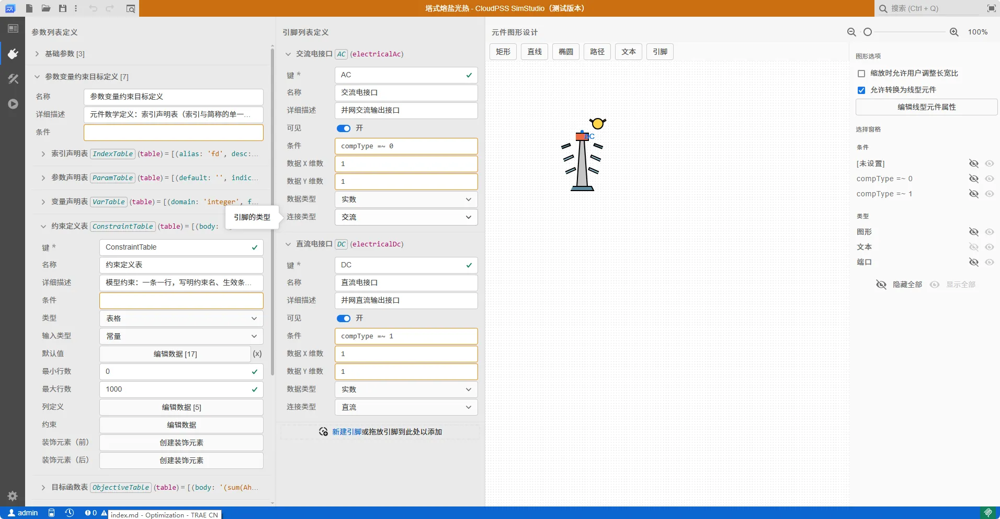

## 功能定义

本文教你**在平台上自定义一个能源设备模型**——不改任何内核代码，只用**元件定义表**（集合 / 参数 / 变量 / 约束 / 目标 / 成本 / 统计）填表，再在约束与目标的 `body` 里写**表达式 DSL**，即可把一台新设备（如塔式光热、某种工艺产线、新型热泵）接入规划与运行优化。

三条要点：

- **后端无关**：你写的是通用数学式（`sum(...) in 域`、`<=`、`Etes[pd-1]`），内核把它编译成表达树 IR，再交给 AMPL / Pyomo / linopy 三个求解后端——**同一份元件定义在三个后端逐值一致**，你无需知道最终用的是哪一家。
- **表格 + 表达式两种输入**：结构（有哪些参数、变量、约束）用表格声明；数学关系（约束体、目标式）用 DSL 表达式书写。
- **以 CSP 塔式光热贯穿示例**：第二章讲语法，第三章用真实 CSP 模型（镜场→吸热器→熔盐储热→汽轮机→电）走一遍"从填表到出模型"的完整过程，可直接对照 `tests/fixtures/csp_element_model.json`。



---

## 一 自定义元件模型的构成

一个元件由下面七部分声明，按顺序填表即可。平台自解析通道下，**集合规模由设备表行数决定**（写几行型号就是几个型号），你只需描述"一类设备长什么样"。

| 部分                | 平台表格                                    | 作用                                            |
| ------------------- | ------------------------------------------- | ----------------------------------------------- |
| 标识与接入          | 元件基本信息                                | 组件类型、能量类型、端口（接交流母线 / 热网…） |
| 集合`sets`        | 集合表 / 设备表                             | 元件内部的索引维度（时段、型号集）              |
| 参数`params`      | 参数表（ParamTable）                        | 已知数据：单价、效率、系数、曲线、规划界        |
| 变量`vars`        | 变量表（VarTable）                          | 决策量：投资台数、逐时功率、存量                |
| 约束`constraints` | 约束表（ConstraintTable）                   | 物理与耦合关系（DSL 表达式）                    |
| 目标`objectives`  | 目标表                                      | 成本项（默认最小化）                            |
| 成本 / 统计         | 成本表 / 统计表（StatsTable·SpecialTable） | 报表口径与结果展示                              |

### 1.1 标识与接入

| 字段                | 含义                           | CSP 取值           |
| ------------------- | ------------------------------ | ------------------ |
| `component_type`  | 元件类型代号（英文，全局唯一） | `csp_tower`      |
| `comp_type_label` | 页面显示名                     | 塔式光热           |
| `energy_type`     | 能量类型（词表内值）           | `electric_ac`    |
| `hub_role`        | 在能源集线器中的角色           | `source`（电源） |
| `pin_type`        | 接入端口类型                   | `ac`（交流母线） |

### 1.2 集合 `sets`（索引域）

集合是"在哪几样东西上建模"的维度。除全局的 `PERIOD`（时段）/`MONTH`/`DAY` 外，元件自声明设备集合。每个集合给 `name` / `definition`（区间记号，如 `0..0`，通用写法非厂商语法）/ `index_var`（该维的索引变量名）。

```json
{"name": "FIELD",         "definition": "0..0", "index_var": "fd"}   // 镜场型号
{"name": "TURBINEPOWER",  "definition": "0..0", "index_var": "tp"}   // 汽轮机型号
{"name": "THERMALSTORAGE","definition": "0..0", "index_var": "ts"}   // 储热型号
```

> 自解析通道下 `definition` 只是缺省规模，**真实型号数=对应设备表的行数**：多填几行就是多型号，无需改定义。

### 1.3 参数 `params`（ParamTable）

参数是"已知数"。每行列：`name` / `indices`（索引哪些集合，空=标量）/ `default` / `unit` / `role`，以及两个语义声明列 **`kind`**、**`scope`** 与可选的 **`source`**（数据来源配方）。

**`kind` 语义分类（取代"靠参数名猜语义"）**：

| kind               | 含义                            | 必填约束                                           |
| ------------------ | ------------------------------- | -------------------------------------------------- |
| `price_invest`   | 投资单价                        | **必须填 `unit`**（元 / 万元口径唯一出处） |
| `price_om`       | 运维单价（年固定 / 按电量变动） | 必须填`unit`                                     |
| `efficiency`     | 效率、系数                      | —                                                 |
| `planning_bound` | 规划界（`Min*`/`Max*`）     | **必须是标量**（`indices` 为空）           |
| `curve`          | 时序曲线（按 PERIOD 索引）      | —                                                 |
| `state`          | 状态量（SOC 系数、初值）        | —                                                 |
| `general`        | 一般参数（缺省）                | —                                                 |

> 单价缺 `unit` 会在声明期被拦截——历史上"元 / 万元混用"造成过报表差 1 万倍的事故。

**`scope` 作用域（取代"参数名以 `_sys` 结尾即表示列均值"的命名魔法）**：

| scope         | 含义                                                                                                                          |
| ------------- | ----------------------------------------------------------------------------------------------------------------------------- |
| `per_model` | 逐型号（设备表某一列，按型号索引）— 缺省                                                                                     |
| `system`    | 系统级等效值（由逐型号列聚合而来），须给`source` 配方；`aggregate` 目前仅 `mean`（逐型号算术平均，分母=设备表实际行数） |

**`source` 数据来源配方**（平台常见四类）：

| source.type                               | 用途                                               | 例                                       |
| ----------------------------------------- | -------------------------------------------------- | ---------------------------------------- |
| `device_col_mean`                       | 由某设备表列聚合出系统级等效标量                   | `etapb_sys ← TurbineTable.etapb 均值` |
| `dni_from_dirhi`                        | 由水平直接辐射 + 天顶角换算逐时法向直射            | `dnipd`（`DNI>0` 时用设计常数）      |
| `day_length` / `annuity` / `pscale` | 引擎注入：每典型日时段数、资本回收系数、典型日缩放 | `pdinday` / `crf` / `pscale`       |

CSP 里"效率与可变运维单价"就写成设备表列（`per_model`），模型式引用其 `system`+`mean` 等效值（`etapb_sys`、`etach_sys`、`VariableOMCost_sys`）——**平台增删型号行，均值自动跟随**，不用手改公式。

### 1.4 变量 `vars`（VarTable）

每行：`name` / `indices` / `domain`（`real`/`integer`/`binary`）/ `lower_bound` / `upper_bound` / `role`。

- **投资决策 = 逐型号数量**（integer）：CSP 的 `Kfield[fd]`、`Kturb[tp]`、`Ktes[ts]`，`role=investment`，结果回填到"配置"；单台容量放设备表列（`Ahelio`/`Punit`/`Eunit`），**总量在约束里写 `Σ(单台容量×数量)`，不设派生总量参数**。
- **运行变量 = 系统级逐时**（`indices=["PERIOD"]`，real，下限 0）：CSP 的充/放/弃热 `Qch/Qdis/Qcurt`、汽轮机进热 `Qpb`、储热存量 `Etes`、理想发电 `Pgen`、弃电 `Pcut`。
- `role` 标注变量物理含义供内核派生与报表识别：`electric_output`、`heat_input`、`state_of_charge`、`electric_curtailment`、`heat_curtailment`、`operational` 等。

### 1.5 约束 `constraints`（ConstraintTable）

每行：`name` / `indices` / `body`（DSL 表达式，含比较符）/ `condition`（可选，仅部分索引成立）/ `role`。界可用 `body` 内比较符 `<= >= ==`，或用 `lower_bound`/`upper_bound` 两列（二者取一，比较符优先）。**平台表格无 `indices` 列时，约束索引由声明推断**（见 2.3）。

### 1.6 目标 `objectives`

每行 `name` / `role` / `body`（表达式，默认最小化）。CSP 四类：投资 `invest`、固定运维 `fixed_om`、可变运维 `var_om`、弃电弃热惩罚 `penalty_curtail`。

### 1.7 节点平衡 / 成本 / 统计

- **节点平衡**：元件向所接端口净注入的功率。CSP 净上网 = `Pgen - Pcut`（理想发电毛值扣弃电）。自解析通道由 `role` 自动派生，也可显式声明 `node_balance_terms`。
- **成本表**：`K 变量 × 单台容量参数 × 单价参数`，与目标里的投资项**同源**，多型号不同单价也逐台恒等；`price_unit` 词头允许"元"或"万元"，内核按声明单点折算，**表达式内不写 `/10000`**。
- **统计表（StatsTable/SpecialTable）**：声明结果展示分组与 8760 曲线口径（哪个量进能量平衡图、正负贡献）。

---

## 二 表达式 DSL 语法

表达式出现在约束 `body`、目标 `body`、变量上下界与节点平衡四处，语法相同。

### 2.1 一条表达式的完整形态

```text
Qch + Qpb + Qcurt == sum(dnipd * FieldRho * FieldEtarec / 1000 * Ahelio * Kfield) in field
Etes == Etes[pd - 1] + etach_sys * Qch - Qdis / etadis_sys
```

### 2.2 求和与作用域 `sum(...) in 域`

- 域写在括号**外**，读作"在……上求和"，是**后缀**，只绑紧邻的那个 `sum(...)`：`sum(a) in field * crf` ≡ `(sum(a) in field) * crf`。
- **`in <域>` 可选**，两种聚合语义由是否写域决定：
  | 写法                | 聚合什么                                                 | 用在哪                                                 |
  | ------------------- | -------------------------------------------------------- | ------------------------------------------------------ |
  | `sum(X) in field` | 只聚`field` 这一维，其余索引（如时段）留给外层逐时约束 | 逐时约束：每时刻成立、按型号求和                       |
  | `sum(X)`          | 聚`X` 内所有符号声明索引的**并集**               | 标量约束与目标：`sum(Ahelio*Kfield) >= MinFieldArea` |
- **多域＝嵌套**：`sum(sum(Qch) in field) in period`（先按型号、再按时间）。不提供 `in (period, field)` 并列写法（避免索引顺序歧义）。
- **域怎么匹配**：先精确、再归一化（大小写与 `-` `_` 空格不计）、归一化后多义则报错并列候选。故 `field`/`FIELD`/`Field` 等价，**页面上看到什么集合名就写什么**。可用域 = 全局 `PERIOD/MONTH/DAY` + 本元件 `sets` 声明的集合。

### 2.3 下标可省 与 声明驱动

裸名按**声明索引**自动注入索引变量，一般不用手写 `[pd]`：

```text
Qch + Qpb              # 约束 indices=["PERIOD"] → 自动 Qch[pd]
Ahelio * Kfield        # 在 in field 域内 → 自动 Ahelio[fd]*Kfield[fd]
kydt                   # 全局参数按 PERIOD → kydt[pd]
```

**唯一要显式写下标的是时间递推偏移**：`Etes[pd - 1]`（上一时段）。方括号是通用数学记号、不是厂商语法。

连带效应：平台表格没有 `indices` 列时，**约束索引由声明推断**——
`引用符号的声明索引 − 被 in<域> 绑定的部分 ⇒ 约束索引`。所以改了集合名要同步改声明与域，否则可能报错或索引判错。

### 2.4 运算符与函数

| 类别     | 写法                                                             | 说明                                                                        |
| -------- | ---------------------------------------------------------------- | --------------------------------------------------------------------------- |
| 四则     | `+ - * /`、一元 `-x`                                         | `*` `/` 优先于 `+` `-`                                              |
| 比较     | `<=` `>=` `==`                                             | **不支持** `<` `>`（MILP 无严格不等式，直接报错）；不支持链式比较 |
| 索引算术 | `Etes[pd - 1]`                                                 | 仅`名字±数字` 单层                                                       |
| 函数     | `max(a,b)` `min(a,b)` `abs(x)` `cos(x)` `sin(x)`       | 解析支持，但**后端能力不等价**（见"使用限制"）                        |
| 数值     | `100` `0.5`                                                  | **不支持科学计数法**（`1e6` 写 `1000000`）                        |
| 保留字   | `sum max min abs cos sin in mod and or not div pd m d kydt` 等 | 不得用作符号名                                                              |

> 幂运算（`x^2`）、`%`（表达式内）、中文标识符都**不支持**并会带位置报错——历史事故是 `x^2` 被静默读成 `x*2`。

### 2.5 条件索引 `condition`

让约束只在部分索引上成立，取值为受限表达式：

```text
"pd >= 1"                          # 递推段
"pd == 0"                          # 初始段
"(pd % pdinday) == (pdinday - 1)"  # 每个典型日最后一时段
"MaxPowerRate > 0"                 # 规划界留空(=0)即无界，填正值才生效
```

- 取余用 `%`、整除用 `//`（旧 AMPL 关键字 `mod`/`div` 已废弃，命中报错并提示替代）；
- 支持 `and` 连接子句，**不支持 `or`**；
- 条件里引用的元件参数/变量会自动加组件 id 后缀。

### 2.6 常见错误与排查

| 现象 / 报错                              | 原因                                           | 处理                                  |
| ---------------------------------------- | ---------------------------------------------- | ------------------------------------- |
| 「检测到旧写法`sum{...}`…已全量替代」 | 用了 AMPL 花括号形态                           | 改写为`sum(...) in 域`              |
| 「`sum(...)` 内没有可聚合的索引符号」  | 括号里全是标量                                 | 放带索引的符号，或改普通算式          |
| 「未登记的域 'x'；可用域：[…]」         | 域拼错或集合未声明                             | 照可用域清单写；确认`sets` 有该集合 |
| 「域 'x' 归一化后多义」                  | 去分隔符撞多个集合                             | 写**精确**集合名                |
| 「引用符号时当前上下文未量化其索引变量」 | 声明索引 /`in<域>` / 约束 `indices` 不一致 | 三者对齐                              |
| 「名称未在变量或参数中声明」             | 引用了未声明符号                               | 去参数表/变量表补声明                 |
| 结果像"元件没生效"、定容恒 0             | 规划界小于单台容量（K 取整台数→0）            | 放宽界或增补小容量型号行              |

---

## 三 CSP 塔式光热实例走查

**物理链路**：镜场集热 → 吸热器 → 熔盐储热（充/放）→ 汽轮机（热→电）→ 电上网。CSP = **镜场 / 汽轮机 / 储热三个独立子系统**的组合，各一张设备表；纯发电（热是内部量，不对外供热网）。

### 3.1 集合与三系统设备表

```text
FIELD / TURBINEPOWER / THERMALSTORAGE   三个 index_var：fd / tp / ts
```

每个系统一张设备表，行=型号，行内含"单台容量"列（镜场 `Ahelio` m²、汽轮机 `Punit` kW、储热 `Eunit` kWh_th）与效率/单价列。

### 3.2 参数（要点）

| 参数                                                                                | kind / scope / source                                                | 说明                                                                          |
| ----------------------------------------------------------------------------------- | -------------------------------------------------------------------- | ----------------------------------------------------------------------------- |
| `etapb_sys` `etach_sys` `etadis_sys` `VariableOMCost_sys`                   | efficiency/price_om ·**system + mean** · `device_col_mean` | 逐型号效率/单价的系统级算术平均，随设备表行数自动跟随                         |
| `MinFieldArea/MaxFieldArea/MinPowerRate/MaxPowerRate/MinStorageCap/MaxStorageCap` | **planning_bound**（标量，默认 0）                             | 容量口径总量界；留空(=0)即无界，靠约束`condition` 控制生效                  |
| `dnipd`                                                                           | **curve** · `dni_from_dirhi`                                | 逐时法向直射辐照（`DNI>0` 用设计常数、仅日照窗口内取值；`=0` 走气象换算） |
| `pdinday` `crf` `pscale`                                                      | `day_length`/`annuity`/`pscale`                                | 引擎注入                                                                      |
| `Kfield/Kturb/Ktes` 用到的 `Ahelio/Punit/Eunit`、`FieldPurchaseCost/…`       | per_model（设备表列）                                                | 逐型号容量与单价（元录入，内核折算万元）                                      |

### 3.3 变量（10 个）

| 变量                          | 索引         | 类型 / role                 | 含义                                 |
| ----------------------------- | ------------ | --------------------------- | ------------------------------------ |
| `Kfield` `Kturb` `Ktes` | 各自设备集合 | integer / investment        | 各系统**型号份数**（定容决策） |
| `Qch`                       | PERIOD       | real / heat_input           | 充热功率                             |
| `Qpb` `Qdis`              | PERIOD       | real / operational          | 汽轮机进热 / 储热放热功率            |
| `Qcurt`                     | PERIOD       | real / heat_curtailment     | 弃热功率                             |
| `Etes`                      | PERIOD       | real / state_of_charge      | 储热存量                             |
| `Pgen`                      | PERIOD       | real / electric_output      | 理想发电功率（毛值）                 |
| `Pcut`                      | PERIOD       | real / electric_curtailment | 弃电功率                             |

净上网 = `Pgen − Pcut`（在节点平衡里表达；无上网约束时 `Pcut` 最优为 0 属预期）。

### 3.4 约束逐类（17 条，全部单边）

**(a) 能量耦合（等式/上限）**

```text
field_alloc        Qch + Qpb + Qcurt == sum(dnipd*FieldRho*FieldEtarec/1000*Ahelio*Kfield) in field
turbine_heat_cap   Qpb + Qdis <= sum(Punit*Kturb) in turbinepower / etapb_sys
power_convert      Pgen == etapb_sys * (Qpb + Qdis)
pc_cap             Pcut <= Pgen
```

**(b) 储热 SOC 三件套（初值 / 递推 / 日末恢复）+ SOC 界 + 充放上限**——演示"下标可省 + `Etes[pd-1]` + `condition`"：

```text
tes_balance_init   条件 pd == 0 :  Etes == socini*sum(Eunit*Ktes) in thermalstorage + etach_sys*Qch - Qdis/etadis_sys
tes_balance        条件 pd >= 1 :  Etes == Etes[pd-1] + etach_sys*Qch - Qdis/etadis_sys
tes_eod_restore    条件 (pd % pdinday) == (pdinday-1) :  Etes == socini*sum(Eunit*Ktes) in thermalstorage
tes_soc_low/up     Etes >= soclow*sum(Eunit*Ktes) in thermalstorage   /   Etes <= socup*…
tes_charge_cap     Qch  <= sum(StorageChCapCoef*Eunit*Ktes) in thermalstorage
tes_discharge_cap  Qdis <= sum(StorageDischCapCoef*Eunit*Ktes) in thermalstorage
```

**(c) 三系统总量界（规划参数，`condition` 防"空值=0 钉死容量"）**

```text
field_area_low/up     sum(Ahelio*Kfield) in field  >= MinFieldArea / <= MaxFieldArea   条件 Min*/Max* > 0
turbine_cap_low/up    sum(Punit*Kturb) in turbinepower …                                条件 Min*/Max* > 0
storage_cap_low/up    sum(Eunit*Ktes) in thermalstorage …                               条件 Min*/Max* > 0
```

### 3.5 目标（4 条，最小化）

```text
invest       ( sum(Ahelio*Kfield*FieldPurchaseCost) in field
             + sum(Punit*Kturb*PowerPurchaseCost) in turbinepower
             + sum(Eunit*Ktes*StoragePurchaseCost) in thermalstorage ) * crf * pscale
fixed_om     同上结构，单价换 FixedOMCost
var_om       sum((Pgen - Pcut) * kydt) in period * VariableOMCost_sys
penalty_curtail  PenaltyRen * ( sum(Qcurt*kydt) in period + sum(Pcut*kydt) in period )
```

要点：投资乘 `crf × pscale`（资本回收 × 典型日缩放）；按电量计的钱乘 `kydt`（`Σ_pd kydt ≈ 8760` → 年 kWh）；单价元录入、内核单点折算万元 ⟹ **表达式内不写 `/10000`**。

### 3.6 从定义表到模型：数据流

```text
平台元件定义表(集合/参数/变量/约束/目标/成本/统计) + args 数值
        → spec 声明 → 表达式 DSL 解析 → 表达树 IR
        → ModelDocument（后端中立）
        → AMPL / Pyomo / linopy 三后端  →  HiGHS/SCIP 求解
        → 结果回填：K* 进"配置"、逐时量进"运行结果"、成本进报表（与目标同源）
```

真实实例见 `tests/fixtures/csp_element_model.json`（含各参数取值与设备表行），可作为你新建元件时的填表范本。

---

## 四 典型场景配置指南

- **纯发电 CSP（默认）**：如上，热仅内部量，净上网 `Pgen−Pcut` 进交流母线。
- **需抑制弃电/弃热**：保留 `penalty_curtail`（乘 `PenaltyRen`），系统会自动在风光/储热充裕时段减少弃电弃热。
- **扩缩容量 / 多型号**：在对应设备表加行（新增型号）即可——效率/可变运维的 `system`+`mean` 等效参数**分母自动跟随行数**，模型式无需改动；投资 `K*` 为整数台数，单台容量列决定每档规模。
- **给定装机、只做运行**：把对应 `K*` 上界=下界钉死（或经两阶段定容后固定），模型退化为纯运行优化。

## 使用限制

- 生产为 **MILP（线性）**。`max/min/abs` 只能作用在**参数/常量**上（构造期求值）；含变量的非线性（变量乘除、变量作分母、含变量的极值）会被后端拒绝，需先线性化。
- 不支持严格不等式 `< >`、科学计数法、幂 `^`、中文标识符。
- 元件内部 DSL 与跨设备**系统约束 DSL** 是两套语言（前者 `in 域`、后者 `@rid`），不要混用。

## 常见问题

- **参数填了不生效**：`planning_bound` 界小于单台容量会让整数台数 `K=0`（有「配置自相矛盾」告警）；`Max*` 留空即无界（`condition` 未成立），非报错。
- **报表金额差 1 万倍**：单价 `kind=price_*` 必须填 `unit`（元/万元），内核按声明折算，勿在公式里再 `/10000`。
- **改完模型结果没变**：确认约束 `indices` 由声明推断正确（改了集合名要同步 `in 域` 与声明）。
